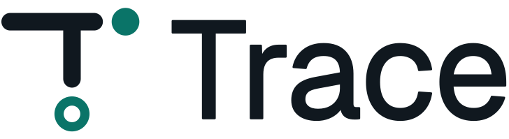

<div align="center">

<picture>
  <source media="(prefers-color-scheme: dark)" srcset="./assets/logo-dark.svg">
  
</picture>

**کانفیگ‌های VLESS را در مرورگر خود بسازید، بررسی کنید و خروجی بگیرید.**

بدون سرور · بدون ثبت‌نام · هیچ چیز از دستگاه شما خارج نمی‌شود

**[باز کردن Trace](https://blackkcore.github.io/Trace/)**

[](#-مجوز)
[](#-حریم-خصوصی)
[](#-شروع-سریع)
[](./README.md)

[🇬🇧 English](./README.md) · **🇮🇷 فارسی**

</div>

---

<div dir="rtl">

**Trace** یک وب‌اپلیکیشن کاملاً سمت کلاینت برای ساخت، بررسی و خروجی گرفتن از کانفیگ‌های VLESS است. همه چیز در مرورگر شما اجرا می‌شود، به فارسی یا انگلیسی و با تم تاریک و روشن.

> ساخته‌شده توسط [@zekk4](https://t.me/zekk4)

---

### 🚀 شروع سریع

Trace یک سایت استاتیک است و به build یا نصب چیزی نیاز ندارد.

**استفاده آنلاین:** [blackkcore.github.io/Trace](https://blackkcore.github.io/Trace/)

**اجرای محلی:**
<div dir="ltr">

```bash
git clone https://github.com/BlackkCore/Trace.git
cd Trace
open index.html        # macOS
start index.html       # Windows
xdg-open index.html    # Linux
```

</div>

**استقرار:**

| پلتفرم | مراحل |
|---|---|
| **GitHub Pages** | Fork → Settings → Pages → شاخه `main`، `/root` |
| **Netlify / Vercel / Cloudflare Pages** | کل پوشه را همراه با `fonts/` و `assets/` آپلود کنید. به هیچ تنظیمی نیاز نیست |

---

### ✨ امکانات

Trace یک مسیر ساده دارد: **ساخت ← بررسی ← خروجی**، به‌علاوه **کتابخانه** برای هر چیزی که ذخیره می‌کنید. با `Ctrl K` از پالت دستورات به هر بخش بروید.

<details open>
<summary><b>⚡ ساخت</b></summary>

- **جای‌گذاری هر ورودی** — لینک `vless://` در فرم بارگذاری و به اجزایش تقسیم می‌شود، چند لینک در بخش بررسی باز می‌شوند و base64 یا URL اشتراک شناسایی می‌شود
- **یک فرم** — UUID، پورت، TLS، ترانسپورت، و در صورت نیاز fingerprint، flow و تنظیمات Reality
- **تولید دسته‌ای** — چند IP یا SNI در هر خط، با پشتیبانی از رنج IP (`1.2.3.1-50`) و CIDR (`104.16.0.0/24`)
- **حالت Pair** — ماتریس کامل یا جفت‌سازی یک‌به‌یک
- **لیست‌های بزرگ** — ده‌ها هزار لینک بدون کندی؛ صفحه ۵۰۰ مورد اول را نشان می‌دهد و خروجی شامل همه آن‌هاست
- **QR کد** برای هر لینک تولیدشده

</details>

<details>
<summary><b>🔍 بررسی</b></summary>

| بخش | کاربرد |
|---|---|
| **سرورها** | پروب `host:port` هر کانفیگ و نمایش کانفیگ‌های تأییدشده در ابتدای لیست |
| **ورودی** | دریافت لینک‌های خام `vless://`، رشته‌های base64 یا URL اشتراک، با حذف موارد تکراری |
| **هاست‌ها** | پروب هر لیستی از IP یا host |
| **اعتبارسنجی** | بررسی فوری UUID، پورت، فیلدهای لازم و تنظیمات TLS، با هشدار برای لینک‌های بدون رمزنگاری |
| **مقایسه** | مقایسه دو لینک `vless://` فیلد به فیلد |

مرورگر نمی‌تواند اتصال ردشده را از اتصال ناموفق تشخیص دهد، پس فقط اتصال کامل‌شده *تأییدشده* حساب می‌شود. بقیه موارد *تأییدنشده* نمایش داده می‌شوند و هرگز در دسترس اعلام نمی‌شوند.

</details>

<details>
<summary><b>📦 خروجی</b></summary>

| بخش | کاربرد |
|---|---|
| **فرمت‌ها** | Clash YAML، JSON برای sing-box، لینک ساده، اشتراک base64 یا JSON، با امکان کپی یا دانلود |
| **بالانسر** | تولید JSON با load-balancing برای **v2rayNG (Xray)** یا **sing-box 1.13+** |
| **تغییر نام** | تغییر نام دسته‌ای remark با قالبی مانند `{prefix}_{ip}_{sni}_{idx}` |

بعضی کانفیگ‌ها روی همه کلاینت‌ها اجرا نمی‌شوند، بنابراین Trace آن‌ها را کنار می‌گذارد و تعدادشان را به شما می‌گوید:
- sing-box از `xhttp` و `splithttp` پشتیبانی نمی‌کند
- Xray کانفیگ VLESS بدون رمزنگاری را برای سرورهای عمومی نمی‌پذیرد

</details>

<details>
<summary><b>🗄 کتابخانه</b></summary>

- **پروفایل‌ها** — ذخیره، جستجو، بارگذاری و ویرایش تنظیمات نام‌دار، با پشتیبان‌گیری JSON
- **UUID** — تولید، نام‌گذاری و ذخیره UUID و انتخاب آن از هر فیلد UUID
- **لیست IP و SNI** — ذخیره لیست‌های نام‌دار و بارگذاری در هر فیلد
- **تاریخچه** — بازگشت به تولیدهای اخیر
- **حذف امن** — حذف قابل بازگردانی است و پاک کردن همه چیز نیاز به نگه داشتن کامل دکمه دارد

</details>

<details>
<summary><b>🌍 پشتیبانی از فارسی</b></summary>

- رابط کامل فارسی و انگلیسی با چیدمان راست‌به‌چپ
- نمایش تاریخ‌ها با تقویم شمسی در حالت فارسی
- فونت‌ها همراه برنامه هستند و چیزی از سرویس‌های دیگر بارگذاری نمی‌شود

</details>

---

### 🛠 پارامترهای VLESS پشتیبانی‌شده

| فیلد | مقادیر |
|---|---|
| Security | `tls` · `reality` · `none` |
| Transport | `xhttp` · `ws` · `grpc` · `splithttp` · `httpupgrade` · `tcp` |
| Fingerprint | `chrome` · `firefox` · `safari` · `ios` · `android` · `edge` · `360` · `qq` · `random` · `randomized` |
| Flow | `xtls-rprx-vision` · none |
| TLS ALPN | `h2` · `http/1.1` · سفارشی |

---

### 📁 ساختار فایل‌ها

<div dir="ltr">

```
Trace/
├── index.html       # پوسته اپ و تمام صفحه‌ها
├── renderer.js      # تمام منطق: تولید، تجزیه، ابزارها، ذخیره‌سازی
├── style.css        # تم‌ها، چیدمان، کامپوننت‌ها، انیمیشن
├── i18n.js          # رشته‌های فارسی و انگلیسی
├── qrcode.min.js    # تولید QR کد (بدون CDN)
├── logo.svg         # آیکون برنامه
├── assets/          # فایل‌های لوگو، آیکون‌ها، تصویر پیش‌نمایش
└── fonts/           # فونت‌های Geist و Vazirmatn (مجوز SIL Open Font)
```

</div>

---

### 🔒 حریم خصوصی

تمام پردازش‌ها در مرورگر انجام می‌شود و داده‌های شما در `localStorage` روی دستگاه خودتان می‌ماند. هیچ داده‌ای به سرور Trace ارسال نمی‌شود، چون چنین سروری وجود ندارد.

تنها درخواست‌های خارجی:
- **بررسی سرور و هاست** — اتصال به hostهایی که شما وارد می‌کنید، از مرورگر خودتان
- **دریافت URL اشتراک** — یک HTTP GET به URL‌ای که در بخش ورودی وارد می‌کنید
- **probe بالانسر** — فقط اگر کانفیگ تولیدشده را در کلاینت پروکسی اجرا کنید

---

### 📄 مجوز

© [@zekk4](https://t.me/zekk4) — تمام حقوق محفوظ است.

استفاده شخصی و غیرتجاری مجاز است. کپی، تغییر، توزیع مجدد یا استفاده در پروژه‌های دیگر بدون اجازه کتبی صریح از نویسنده مجاز نیست.

</div>
